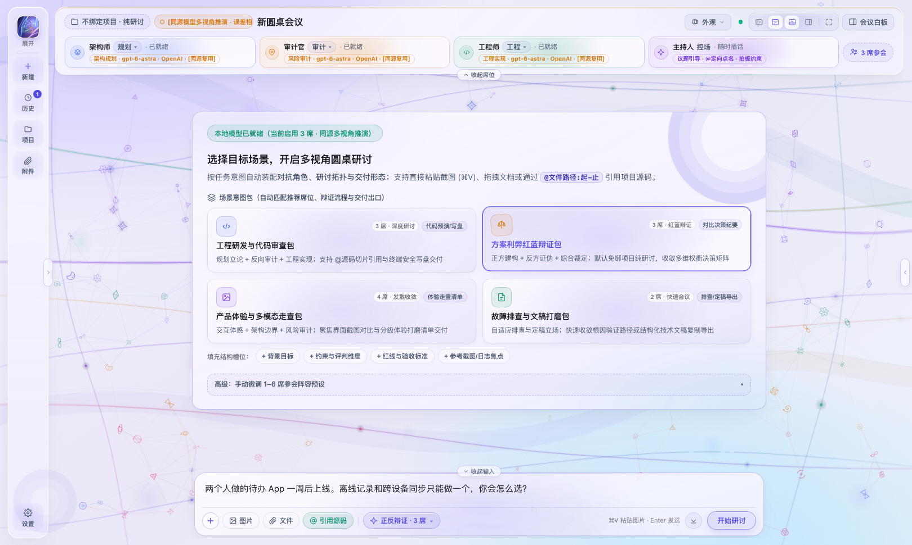

# AI Roundtable · Give your best idea a dissenting voice.

English · [简体中文](README.md)

When an AI says “this should work,” give another seat one job: **tell me when it won’t.** AI Roundtable puts 1–6 AI seats in the same discussion on Windows or Mac. One can pitch an idea, another can challenge its assumptions, and a third can turn the disagreement into a test. No copying answers between chat windows. You make the call.

**[Download for Windows x64](https://github.com/Catcherog/ai-roundtable/releases/latest/download/AI-Roundtable-Windows-x64.zip)** · **[Download for Apple silicon](https://github.com/Catcherog/ai-roundtable/releases/latest/download/AI-Roundtable-macOS-arm64.zip)** · [Release notes & checksums](https://github.com/Catcherog/ai-roundtable/releases/latest)

The interface is in Simplified Chinese. Already using v4.0.2? [Back up your meetings before upgrading.](#upgrading-from-v402)

<picture>
  <source media="(prefers-color-scheme: dark)" srcset="docs/images/roundtable-5.5.1-dark.png">
  
</picture>

## Try a question that forces a choice

First, make sure a supported command-line AI tool, such as Codex or Claude Code, can answer a question in your terminal. In Roundtable, open Settings (Ctrl+, on Windows; ⌘, on Mac). Under **席位与模型** (Seats & models), assign a working tool and model to each participating seat, then save. One signed-in tool can play several roles; connect different models when you want a second model’s take.

Choose **方案利弊红蓝辩证包** (Trade-off debate), paste this prompt, and click **开始研讨** (Start). No project folder needed:

> Our two-person team ships a to-do app in a week. We can build offline capture or cross-device sync, not both. Assign one seat to argue for each. What evidence would make each side change its mind? Give us one test we can run tomorrow.

Then change one fact: **“Our first users commute on trains with no signal.”** See who revises their advice and why. Use **形成决议** (Form a decision) to wrap up; edit the whiteboard and export the discussion as Markdown. The interesting part isn’t the vote. It’s which assumptions survive the follow-up.

## What would you put on the table?

| Bring this | Ask this | Take away |
| --- | --- | --- |
| A choice between two plausible plans | “Which assumption would cost us the most if it were wrong?” | A trade-off you can explain and a small experiment to run. |
| Code you’re about to change | Cite a file and line range with `@`, then ask for an input that breaks the implementation. | Findings you can trace to source. Preview changes read-only before allowing writes. |
| A confusing screen | Drop in a screenshot and ask what a first-time user would click next and why. | A list of specific issues you can check against the screen. Use an image-capable model. |

[See a real three-seat discussion from an earlier release](docs/images/roundtable-session.png): one seat suggested a runoff, another wanted the tie-breaker announced before voting, and a third noticed that retrying a draw must not produce a different winner.

## Before you install

- **Windows 10/11 x64:** extract the entire ZIP, then open `AI-Roundtable.exe`. Python and .NET are bundled. If prompted, install Microsoft’s [Edge WebView2 Runtime](https://developer.microsoft.com/microsoft-edge/webview2/).
- **Apple silicon:** requires macOS 12 or later and Python 3.9+. Extract the ZIP and move `AI圆桌.app` to Applications. If macOS asks you to verify its source, check the release checksum and see [Apple’s guidance](https://support.apple.com/en-us/102445).
- **Bring your own model access.** Meetings and settings are stored locally; cloud tools may send questions, attachments, and cited code to their provider and use your quota. Discuss without binding a folder, or start project work with a read-only preview.

### Upgrading from v4.0.2

**Quit the app and back up the whole data directory first:** `~/.ai-roundtable/` on Mac or `%USERPROFILE%\.ai-roundtable` on Windows. On save, 5.5.1 retains the 50 most recent meetings; a full rewrite of a meeting retains its last 500 messages. Deleted meetings have no recovery bin. Project folders with more than 128 MiB of managed files cannot be bound. If you rely on unlimited history, the recovery bin, or large project roots, you can [stay on v4.0.2](https://github.com/Catcherog/ai-roundtable/releases/tag/v4.0.2).

[User guide & source builds (Chinese)](docs/guide.zh-CN.md) · [Verification notes](docs/verification.md) · [Share a question or report an issue](https://github.com/Catcherog/ai-roundtable/issues)
