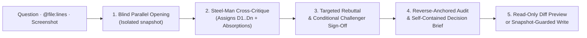

<h1 align="center">AI Roundtable · AI 圆桌</h1>

<p align="center">
  <strong>Give your best idea a dissenting voice — and walk away with a decision brief you can ship.</strong>
</p>

<p align="center">
  <code>Windows 10/11 x64</code> · <code>macOS 12+ Apple silicon</code> · <code>100% Python stdlib</code> · <code>Local SQLite</code> · <code>Bring Your Own CLI</code>
</p>

<p align="center">
  <strong>English</strong> · <a href="README.zh-CN.md">简体中文</a> · <a href="docs/guide.zh-CN.md">使用手册</a> · <a href="docs/verification.md">Benchmarks &amp; CI Checks</a>
</p>

<p align="center">
  <a href="https://github.com/Catcherog/ai-roundtable/releases/latest/download/AI-Roundtable-Windows-x64.zip"><strong>⬇ Download for Windows x64</strong></a>
  &nbsp;·&nbsp;
  <a href="https://github.com/Catcherog/ai-roundtable/releases/latest/download/AI-Roundtable-macOS-arm64.zip"><strong>⬇ Download for macOS (Apple silicon)</strong></a>
  &nbsp;·&nbsp;
  <a href="https://github.com/Catcherog/ai-roundtable/releases/latest">Release notes &amp; SHA-256</a>
</p>

The downloads above are the free standard desktop edition. Catcherog's separately maintained **Audit Pro desktop edition** adds a local JSON audit workspace with sign-off validation and paired ledger and Markdown exports. Coding agents can also use the standalone workflows on Agensi. [Free Code & Plan Review](https://www.agensi.io/skills/roundtable-steel-man-code-plan-review) · [Paid PR & Architecture Audit skill](https://www.agensi.io/skills/adversarial-pr-architecture-audit-pro)

AI Roundtable is a local-first Windows and macOS desktop app for architecture, code review, product prioritization, and troubleshooting decisions that deserve real pushback. Seat **1–6 AI roles** around the same problem — starting with a single CLI tool you already use, or mixing **Codex, Claude Code, Antigravity (Gemini), Grok, and Ollama** at the same table with per-seat models and reasoning effort levels.

Instead of polite single-chat agreement or messy multi-tab copy-pasting, AI Roundtable runs a structured **blind opening → itemized cross-critique (`D1..Dn`) → targeted rebuttal → conditional challenger sign-off → multi-seat audited decision brief** pipeline, then lets you preview or apply selected tasks with pre-write byte snapshots and conflict-checked rollback. *(The app interface is in Simplified Chinese.)*

<picture>
  <source media="(prefers-color-scheme: dark)" srcset="docs/images/roundtable-5.5.1-dark.png">
  
</picture>

## Why not just open three chat tabs?

| Opening 3 chat tabs manually | Running a session in AI Roundtable |
| :--- | :--- |
| **Copy-paste fatigue & anchoring:** Later prompts get biased by how you summarize earlier answers. | **Blind parallel opening:** Every seat forms its initial architecture or root-cause thesis on an isolated snapshot before seeing peers. |
| **Hand-wavy excuses pass unchallenged:** A criticized model says "not an issue" and moves on. | **Itemized `D1..Dn` ledger & Challenger Sign-Off:** Every critique gets an ID. Accepted fixes fast-path; counter-proof refusals wake the original challenger to verify or lock the dispute as a conditional fallback. |
| **Summaries flatten away hard details:** Single-model summaries drop SQL schemas, thresholds, and edge cases, or resurrect rejected ideas. | **Lossless Self-Contained Decision Brief:** Extracts each seat's latest post-rebuttal contracts, runs reverse-anchored multi-seat sign-off, rescues omitted code blocks via **Delta Guard**, and quarantines rejected proposals in a negative list. |
| **Fake "consensus" from one model:** Three prompts on the same model look like independent agreement. | **Epistemic provenance badges:** Flags `[Single-seat]`, `[Homogeneous multi-perspective]` (with orthogonal audit lenses per seat), vs. `[Heterogeneous cross-verified]` consensus, and separates `Chair directives`. |
| **Disconnect between debate and code:** You still have to rewrite the final prompt for your coding agent. | **Contract-passthrough execution & CAS rollback:** Sends checked tasks + the full final contract + banned-proposal guardrails to your chosen executor seat, backed by pre-write snapshots. |

## How a roundtable converges



<details>
<summary><strong>Preview: What the exported "Self-Contained Decision Brief" looks like</strong></summary>

When you click **Form a decision** (`形成决议`) and **Copy Decision Brief** (`复制决策包`) or **Export .md** (`导出 .md`), you get a single Markdown package ready to paste into an RFC, pull request, or coding agent — without losing code contracts or letting rejected ideas sneak back in:

```markdown
# 《AI圆桌决策包》 — Cross-Region State Ledger & Retry Strategy
> Epistemic status: `[异构独立引擎交叉核验]` | Strategy: Deep Deliberation | Audit: Verified by 3 auditor seats

## 一、核心决策总览（TL;DR）
- Adopt monotonic `fencing_ledger_v3` lease validation with 4-tier jittered backoff; ban unguarded raw pointer swaps.

## 二、已确认共识与完整实施方案
```sql
CREATE TABLE fencing_ledger_v3 (epoch BIGINT PRIMARY KEY, fencing_token TEXT NOT NULL);
```

## 三、多 AI 思想精华与纠偏演进表
| 核心议题 | 初始方案 | 纠偏来源与盲区指出 | 终态采纳方案与精华归属 |
| :--- | :--- | :--- | :--- |
| Split-brain guard | Raw lock table | UX/Audit flagged stale-leader overwrite | `fencing_ledger_v3` (Architect + Red Team) |

## 四、已确认放弃与证伪淘汰方案（防回流负面清单）
- [已淘汰] `CREATE TABLE raw_lock_v1` — Lacks fencing token under network partition; strictly banned in implementation.

## 五、高价值少数派意见与条件触发预案
- When billing settlement QPS > 5,000 or zero-RPO is required → switch async replication to semi-sync quorum (Source: Lead Eng).

## 六、边界风险防线、参会披露与文件级待执行任务清单
- [x] Implement `fencing_ledger_v3` schema & 250ms lease circuit breaker
- [ ] Add background thread-pool hashing for payloads > 64MB

## 附：会议白板全量台账同步（零遗漏核对）
### 未合入独创技术契约与代码块差集补录 (Delta Guard)
- Automatically appends any surviving per-seat code contract omitted by the lead synthesizer, with zero duplication.
```
</details>

<a name="核心亮点"></a>
<a name="highlights"></a>

## Highlights

- **Five collaboration topologies for different stakes:** Choose **Deep Deliberation** (`深度研讨`), **Adversarial Red/Blue Review** (`正反辩证`, scaling across 2–6 seats with zero idle bystanders), **Divergent-Convergent Exploration** (`发散收敛`), **Source-Grounded Code Review** (`代码审查`), or **Rapid Consensus** (`快速合议`).
- **Mutual error-correction without tag fatigue:** Seats steel-man the opposing mechanism before attacking concrete failure modes, cross-pollinate strengths (`跨席互认思想精华`), and update their own terminal contracts. If you ask follow-up questions after generating a decision, **Stale Resolution Guard** automatically highlights the post-decision delta at the top of your brief.
- **Reopen a single point of contention:** Pick any risk or `D#` item on the whiteboard for a focused **1-round two-seat re-debate** (`焦点再辩`), `@mention` a specific seat mid-meeting, or click any whiteboard author badge to jump straight to the source message.
- **Ground debates in real code and UI screenshots:** Bind a local folder to cite exact line ranges (`@backend/storage.py:73-84`), or drag-and-drop UI screenshots so multimodal seats can audit visual hierarchy and first-click confusion.
- **Zero-dependency local architecture:** Pure Python 3.9+ standard library backend, local SQLite storage (`~/.ai-roundtable/`), process-tree watchdogs, and native WebView2 (Windows) / Cocoa WKWebView (macOS) shells. Your API keys and CLI logins stay in your own terminal tools.
- **Measured parallel speed:** On an Apple silicon Mac, a single signed-in Antigravity CLI ran 6 concurrent seat processes — finishing all 6 opening statements in **29.3 s** and the full synthesized session in **57.7 s**. [See full 3–6 seat benchmarks and Windows CI checks](docs/verification.md).

<a name="看一场真实讨论"></a>
<a name="a-real-three-seat-discussion"></a>

## A real three-seat discussion

**How should a fruit poll return a single winner when the top choices tie?** In one session, the architect suggested a runoff among the tied choices. The auditor spotted a fairness flaw: voters must know the tie-breaker *before* the poll opens, or the rule looks rigged. The engineer caught an idempotency bug: recalculating the same poll must reuse the first random draw rather than re-rolling.

The resulting rule went straight into code: announce the tie-breaker upfront, run at most one runoff, draw with equal odds if still tied, and persist the first valid draw per poll ID. [View the original session screenshot](docs/images/roundtable-session.png).

<a name="你手边的事适合哪一桌"></a>
<a name="pick-a-session-for-the-decision-at-hand"></a>

## Pick a session for the decision at hand

| Bring this | Choose this preset in the app | Try asking |
| :--- | :--- | :--- |
| Two competing product or architecture plans | **Trade-off debate** (`方案利弊红蓝辩证包`) | “We can fund only one. What concrete failure case or metric would make the advocate for A switch to B?” |
| Code you are about to refactor or ship | **Engineering review** (`工程研发与代码审查包`) | “What breaks if this endpoint is called twice concurrently? Cite exact lines and give a regression test.” |
| A screen that confuses first-time users | **Design critique** (`产品体验与多模态走查包`) | “Where will a new user click first? Point to the visual cue that steers them there.” |
| An incident postmortem or technical draft | **Troubleshooting & editing** (`故障排查与文稿打磨包`) | “Separate verified observations from unverified root-cause assumptions. What single check rules out the top suspect?” |

<a name="第一场会就问一道有取舍的题"></a>
<a name="try-a-question-that-forces-a-choice"></a>

## Try your first session in 2 minutes

### Option A: Desktop app (Windows & macOS)

| Platform | First launch |
| :--- | :--- |
| **Windows 10/11 x64** | Extract the full ZIP and run `AI-Roundtable.exe`. Python and .NET are bundled; uses Microsoft [Edge WebView2 Runtime](https://developer.microsoft.com/microsoft-edge/webview2/). |
| **macOS (Apple silicon)** | Requires macOS 12+ and Python 3.9+. Extract the ZIP and drag `AI圆桌.app` to Applications. ([First-launch verification tip](https://support.apple.com/en-us/102445)) |

### Option B: Run from source in 30 seconds (Zero `pip install`)

Because the backend uses **100% Python standard library**, you can launch the full web workbench directly from source on macOS or Linux once at least one supported CLI (`codex`, `claude`, `agy`, `grok`, or `ollama`) works in your terminal:

```bash
git clone https://github.com/Catcherog/ai-roundtable.git
cd ai-roundtable
bash scripts/start_web.sh
```

### A first question worth testing

1. Open **Settings** (`Ctrl+,` on Windows / `⌘,` on Mac), assign your working CLI and model under **Seats & models** (`席位与模型`), and save.
2. Pick **Trade-off debate** (`方案利弊红蓝辩证包`), paste the prompt below, and click **Start** (`开始研讨`):

   > Our two-person team ships a to-do app in a week. We can build only one feature: offline capture or cross-device sync. Have one seat argue for each, state what evidence would make each side switch, and give us one validation test we can run tomorrow.

3. After Round 1 finishes, inject a live constraint: **“Our first users commute on subways with zero signal.”** Watch which seat revises its contract, click **Form a decision** (`形成决议`), and click **Copy Decision Brief** (`复制决策包`) to inspect the final package.

<a name="安装与数据"></a>
<a name="installation-and-data"></a>

## Privacy, data & local storage

- **100% local state:** All session history, whiteboards, attachments, and CAS workspace backups live on your machine (`~/.ai-roundtable/` on macOS, `%USERPROFILE%\.ai-roundtable` on Windows).
- **Bring your own CLI / local model:** AI Roundtable includes no telemetry or middleman proxy. Cloud CLIs send prompts and cited files directly to their respective providers under your own account; use **Ollama** for fully offline local sessions.
- **Guides & verification:** [Chinese User Guide](docs/guide.zh-CN.md) · [Build macOS `.app` / Windows `.exe` from source](docs/guide.zh-CN.md#源码运行与目录) · [Concurrency & CI verification](docs/verification.md) · [Windows Desktop CI workflow](https://github.com/Catcherog/ai-roundtable/actions/workflows/windows.yml)

<a name="从-v402-升级"></a>
<a name="upgrading-from-v402"></a>

### Upgrading from v4.0.2

**Quit the app and back up your entire data directory first** (`~/.ai-roundtable/` on Mac, `%USERPROFILE%\.ai-roundtable` on Windows, or your custom `AI_ROUNDTABLE_HOME`). Current releases retain the 50 most recent meetings on save and up to 500 messages on full session rewrite. Meeting deletion is permanent. Users who rely on unlimited legacy retention can [stay on v4.0.2](https://github.com/Catcherog/ai-roundtable/releases/tag/v4.0.2).

Starting with v5.9.0, both desktop apps can bind a full project for discussion and search across its directories. For workspaces above 128 MiB, macOS can apply approved text edits and snapshot only the targeted files when read-only sandboxing is available. Windows supports discussion and read-only preview for workspaces above that size.

<p align="center">
  <a href="https://github.com/Catcherog/ai-roundtable/issues">Report an issue or share a question worth debating →</a>
</p>
