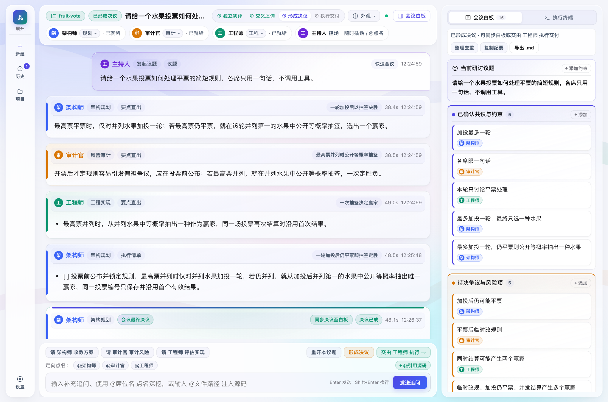

# AI 圆桌

[English](README.en.md) · **简体中文**

在 Windows 或 macOS 上，把同一道题交给 1–6 个 AI 席位。你可以让架构师提方案、让审计官找反例，再请工程师给出实施步骤。每个席位都能使用自己的 CLI、模型和推理档位，也能共用一个已登录的账号。

**[下载 Windows x64](https://github.com/Catcherog/ai-roundtable/releases/latest/download/AI-Roundtable-Windows-x64.zip)** · **[下载 macOS Apple 芯片版](https://github.com/Catcherog/ai-roundtable/releases/latest/download/AI-Roundtable-macOS-arm64.zip)** · [使用手册](docs/guide.zh-CN.md) · [版本与校验值](https://github.com/Catcherog/ai-roundtable/releases/latest)

## 一场会议如何得到可执行的结果

上图这场会只问了一件事：「水果投票并列第一，怎么选出唯一赢家？」同一个 Codex CLI 分饰三个角色。架构师建议加投一次，审计官提出必须在开票前公布规则，工程师补充同一场抽签重试时应沿用第一次的结果。最后的规则同时覆盖了平票、公平性和重复执行。

| 你想做的事 | 圆桌提供的操作 |
| --- | --- |
| 比较方案或审查代码 | 从快速合议、深度研讨、正反辩证、发散收敛、代码审查中选一种。需要追问时用 `@席位名`，要核对源码时用 `@backend/server.py:31-62` 指定行。 |
| 留下可复查的决议 | 白板分别记录已确认的约束、风险和待执行任务。你可以采纳、修改或取消勾选，再将决议、任务和原始发言导出为 Markdown。 |
| 把选定的任务交给 AI | 先在「只读预演」查看改动建议。绑定项目后可授权写入，指定执行席位，并配置完成后要运行的验证命令。 |

## 第一场会

| 平台 | 打开方式 |
| --- | --- |
| Windows 10/11 x64 | 完整解压 ZIP，双击 `AI-Roundtable.exe`。包内自带 Python 和 .NET，桌面窗口使用 Edge WebView2。[WebView2 运行时](https://developer.microsoft.com/microsoft-edge/webview2/) |
| Apple 芯片 Mac | 将 `AI圆桌.app` 拖入「应用程序」。本机需有 Python 3.9 或以上版本。[首次打开说明](docs/guide.zh-CN.md#安装与首次打开) |

在终端安装并登录至少一个受支持的 CLI：Antigravity（`agy`）、Codex（`codex`）或 Grok（`grok`）。打开圆桌设置（Windows **Ctrl+,**，Mac **⌘,**），选好阵容、驱动和模型，点击「保存配置」。「实测连通」会发起真实模型请求。回到会议选择「快速合议」，输入议题即可开始。

## 技术上怎样做到

- **同一 CLI 可以并行。** 同一可执行文件的席位共享并发上限，每次独立调用获得单独的临时目录。一次 Mac 实测中，单个 Gemini CLI 的六个真实进程同时运行，六席首轮在 29.3 秒内完成，含汇总共 57.7 秒。[测试条件与记录](docs/verification.md)
- **断线后能接着看。** 每个会议事件都有递增序号。窗口按最后收到的序号续接，如果缺失的事件超过缓冲区，就重新加载会议快照。消息和白板保存在本机 SQLite 中。
- **回滚会核对后来的改动。** 写入前为受管文件建立 SHA-256 快照，并对同一工作区加写锁。一般被 Git 忽略的普通文件也受管；未纳入 Git 跟踪的 `output/` 和 `.app` 目录不纳入快照。超过 128 MiB 的项目可以绑定根目录并跨目录编辑文本源码。圆桌写入前会核对原文，仅为本轮目标文件建立快照，目标文件修改前和修改后分别最多 128 MiB。回滚不撤销 Git 提交、远端推送或工作区外的副作用；发现手动编辑冲突时会保留现场。
- **桌面与模型各自运行。** Windows 使用 WebView2，macOS 使用 WKWebView。界面通过经身份验证的本机回环服务调度 CLI。选用的 CLI 会按自身服务规则把提示词和引用的项目内容发送给模型提供方。

从源码运行或构建见[使用手册](docs/guide.zh-CN.md#源码运行与目录)。[反馈问题](https://github.com/Catcherog/ai-roundtable/issues)
