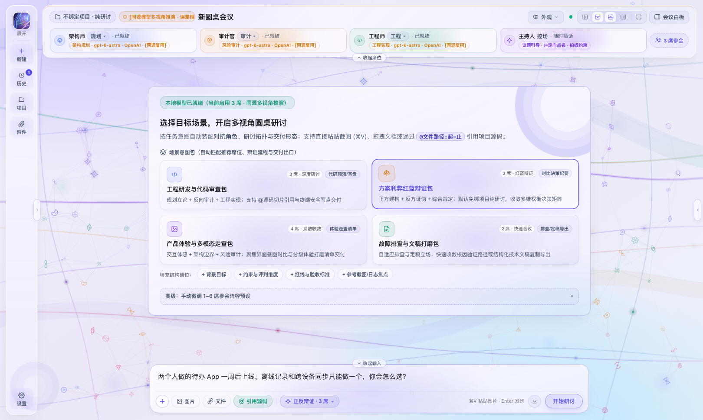
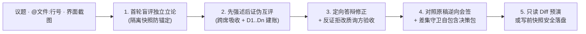

<h1 align="center">AI 圆桌 · AI Roundtable</h1>

<p align="center">
  <strong>好方案，值得一个反对席——把多 AI 思维碰撞变成一份可直接落地的自包含决策包。</strong>
</p>

<p align="center">
  <code>Windows 10/11 x64</code> · <code>macOS 12+ Apple 芯片</code> · <code>Python 纯标准库零依赖</code> · <code>本地 SQLite</code> · <code>自带 CLI 账号与离线模型</code>
</p>

<p align="center">
  <strong>简体中文</strong> · <a href="README.md">English</a> · <a href="docs/guide.zh-CN.md">安装与使用手册</a> · <a href="docs/verification.md">并发实测与验证记录</a>
</p>

<p align="center">
  <a href="https://github.com/Catcherog/ai-roundtable/releases/latest/download/AI-Roundtable-Windows-x64.zip"><strong>⬇ 下载 Windows x64 桌面版</strong></a>
  &nbsp;·&nbsp;
  <a href="https://github.com/Catcherog/ai-roundtable/releases/latest/download/AI-Roundtable-macOS-arm64.zip"><strong>⬇ 下载 Apple 芯片 Mac 版</strong></a>
  &nbsp;·&nbsp;
  <a href="https://github.com/Catcherog/ai-roundtable/releases/latest">发行说明与 SHA-256 校验值</a>
</p>

**AI 圆桌**是一款运行在本机的 Windows 与 macOS 多智能体协同决策桌面应用。把一个架构选型、代码审查、产品取舍或疑难排障问题交给 **1–6 个 AI 席位**：你可以只用一个已登录的命令行工具分饰多角，也可以让 **Codex、Claude Code、Antigravity (Gemini)、Grok 与 Ollama** 同桌交锋，逐席指定模型与推理档位。

它解决的不是“多开几个聊天框同时问”，而是**让不同 AI 在制度化流程里真正互相纠偏、互认亮点、防假闭环，并把各席不同思想的精华无损收口为一份可以直接拿去研发落地的决策文本**。

<picture>
  <source media="(prefers-color-scheme: dark)" srcset="docs/images/roundtable-5.5.1-dark.png">
  
</picture>

## 为什么不直接开 3 个网页聊天框来回复制？

| 手动多开聊天窗口来回粘贴 | 使用 AI 圆桌闭环研讨 |
| :--- | :--- |
| **锚定偏差与客套附和**：手动转述容易带入倾向，模型顺着话头礼貌赞同 | **首轮盲评物理隔离 + 正交审查标尺**：首轮冻结上下文独立破题；同源单引擎参会时自动为各席分配正交审计维度并显式标注同源防伪徽章 |
| **被批评方自说自话“糊弄过关”**：一句“影响不大”就把质疑混过去 | **`D1..Dn` 编号攻防 + 条件式质询方验收**：每条质疑自动建账；接受修正零延迟直通，若主张“量化反证拒改”则自动唤醒原质询席位短验收，不认可即锁定为保留异议与条件预案 |
| **最后汇总把硬核细节“概括没了”**：单主笔总结常漏掉 SQL 表结构、阈值或把已否决方案混回正文 | **倒序终态快照 + 逆向会签 + 差集守卫（Delta Guard）**：优先提取各席纠偏后的终态契约，审稿席对照自身原稿块级查漏，主笔漏写的代码块自动差集补录，淘汰废案物理隔离进负面清单 |
| **追问之后旧纪要与新结论打架**：补充几轮追问后忘了重算总结，复制出过期结论 | **决议时效脏状态防呆**：决议生成后一旦发生追问或焦点再辩，自动置顶《决议后最新追问与方案纠偏增量》并高亮提醒一键刷新 |
| **讨论与改代码脱节**：还得自己重新挑重点写执行 Prompt | **主刀契约直通 + 写前字节快照回滚**：勾选待办后，执行席同时拿到完整决议契约与“严禁回流废案禁令”，支持只读 Diff 预演与冲突检测级原子回滚 |

## 全链路思维碰撞与无损收口机制



<details>
<summary><strong>点击预览：散会后一键复制的《AI圆桌自包含决策包》长什么样？</strong></summary>

点击「形成决议」后再点「复制决策包」或「导出 .md」，无需翻看冗长聊天记录，即可拿到一份**零契约截断、零废案回流、零重复堆砌**的完整落地文档：

```markdown
# 《AI圆桌决策包》 — 跨机房防脑裂状态账本与重试机制
> 认知防伪：`[异构独立引擎交叉核验]` | 场景策略：工程研发与代码审查包（深度研讨） | 终稿会签：已通过多席会签 · 无遗漏

## 一、核心决策总览（TL;DR）
- 采用单调递增 `fencing_ledger_v3` 租约原子状态表配合四级抖动退避；严禁无引用计数裸切指针。

## 二、已确认共识与完整实施方案
```sql
CREATE TABLE fencing_ledger_v3 (epoch BIGINT PRIMARY KEY, fencing_token TEXT NOT NULL);
```

## 三、多 AI 思想精华与纠偏演进表
| 核心议题 | 初始方案 | 纠偏来源与盲区指出 | 终态采纳方案与精华归属 |
| :--- | :--- | :--- | :--- |
| 脑裂防护 | 单表裸写锁 | 交互与红队指出旧主覆盖风险 | `fencing_ledger_v3`（首席架构 + 红队审计） |

## 四、已确认放弃与证伪淘汰方案（防回流负面清单）
- [已淘汰] `CREATE TABLE raw_lock_v1` —— 缺少 fencing 校验，网络分区下会导致脏写，实施阶段严禁回流。

## 五、高价值少数派意见与条件触发预案
- 涉及核心账务流水（严禁 1 秒 RPO 丢单）时 → 自动切换半同步多数派确认预案（来源：研发主程）。

## 六、边界风险防线、参会披露与文件级待执行任务清单
- [x] 落地 `fencing_ledger_v3` 状态表与 250ms 租约熔断
- [ ] 为大于 64MB 对象补充后台线程池哈希计算

## 附：会议白板全量台账同步（零遗漏核对）
### 未合入独创技术契约与代码块差集补录
- 自动比对各席终态契约与主笔正文：正文已收录者零重复，主笔漏写的独创代码块（如退避抖动矩阵常量）原样补齐。
```
</details>

<a name="核心亮点"></a>

## 核心亮点

- **5 种研讨拓扑覆盖不同复杂度**：内置 **深度研讨**、**正反辩证**（支持 2–6 席红蓝编组全员参战，第 4–6 席绝不闲置旁观）、**发散收敛**（多维正交方案探索后三维评估收敛）、**代码审查**（强制源码行号与调用链交叉核验）与 **快速合议**。
- **跨席互认思想精华谱系**：右侧白板实时沉淀「谁吸收了谁的哪条独创洞察」，点击任意条目或作者徽章即可一键跳回左侧原发言卡片核对上下文与前置条件。
- **单点争议拉出再辩**：对白板上的任意风险或未决 `D#` 分歧点「双席再辩 1 轮」，只唤醒相关两席正面交锋；支持中途插话追加硬约束或 `@席位名` 定向追问。
- **原生源码行号引用与多模态看图走查**：绑定本地项目目录后输入 `@backend/storage.py:73-84` 精准喂入代码片段；支持直接粘贴或拖入界面截图，让多模态模型做首屏视觉动线与误触走查。
- **纯标准库零依赖与真并发速度**：后端 100% 采用 Python 3.9+ 标准库实现（零 `pip install` 第三方运行时依赖），本地 SQLite 持久化。Apple 芯片 Mac 实测单套已登录 Antigravity CLI 6 席真并行立论仅需 **29.3 秒**，整场含汇总 **57.7 秒**。[查看 3–6 席实测数据与 Windows 验证记录](docs/verification.md)

<a name="看一场真实讨论"></a>

## 看一场真实讨论

**如果水果投票并列第一，怎么选出唯一赢家？** 一次三席会议里，架构师提议只给并列水果加投一轮；审计官抓住了规则公布时机——开票后再定怎么处理平票，极易让人质疑偏袒；工程师又补了一条幂等边界——同一场投票重复结算时，必须复用第一次抽签结果而不能重抽。

最终沉淀出的规则可直接写进代码：投票前先公示规则，最多加投一轮，仍平票再等概率抽签，且同一投票 ID 锁定首次有效结果。[查看早期版本真实讨论截图](docs/images/roundtable-session.png)

<a name="你手边的事适合哪一桌"></a>

## 你手边的事，适合哪一桌？

| 要做的决定 | 开场页选择 | 可以这样问 |
| :--- | :--- | :--- |
| 在两个产品或技术方向中二选一 | **方案利弊红蓝辩证包** | 预算只够做一个。哪条反例或量化证据会让支持 A 的席位改选 B？ |
| 审一段即将上线的核心代码 | **工程研发与代码审查包** | 这段逻辑遇到并发重复提交会发生什么？请指出文件路径与函数，再给一个回归测试方案。 |
| 查清界面为什么让新用户点错 | **产品体验与多模态走查包** | 请看这张截图。第一次进来的用户会先点哪里？哪个视觉线索把他引向了那里？ |
| 线上故障复盘或打磨技术方案 | **故障排查与文稿打磨包** | 区分哪些是已观测到的事实、哪些是未证实的猜测；下一步做什么最小验证能排除头号嫌疑？ |

<a name="第一场会就问一道有取舍的题"></a>

## 2 分钟试开你的第一场圆桌

### 方式一：直接运行桌面安装包（推荐）

| 平台 | 首次打开方式 |
| :--- | :--- |
| **Windows 10/11 x64** | 完整解压 ZIP，双击 `AI-Roundtable.exe` 即可运行（已内置 Python 与 .NET，窗口基于系统 [Edge WebView2](https://developer.microsoft.com/microsoft-edge/webview2/)）。 |
| **Apple 芯片 Mac** | 需要 macOS 12+ 与 Python 3.9+。解压后将 `AI圆桌.app` 拖入「应用程序」即可（[首次打开提示说明](docs/guide.zh-CN.md#安装与首次打开)）。 |

### 方式二：源码 30 秒零依赖启动（无需安装任何 pip 包）

只要终端里已有任意一个可用 CLI（`codex`、`claude`、`agy`、`grok` 或本地 `ollama`），3 行命令即可在浏览器打开完整工作台：

```bash
git clone https://github.com/Catcherog/ai-roundtable.git
cd ai-roundtable
bash scripts/start_web.sh
```

### 第一场会，试试这道有取舍的真问题

1. 按 `⌘,`（Mac）或 `Ctrl+,`（Windows）打开「设置 → 席位与模型」，为参会席位选好本地可用的驱动与模型并保存。
2. 开场页选择 **「方案利弊红蓝辩证包」**，粘贴下面这道题，点击 **「开始研讨」**（无需绑定项目目录）：

   > 我们两个人做的待办 App 一周后上线，只够做「离线记录」或「跨设备同步」中的一个。请正反两席各替一个方案辩护，再各说一条会让自己改主意的证据。最后，给我一个明天就能做的验证。

3. 等首轮交锋结束，在底部追加一句新约束：**「补充事实：首批种子用户每天通勤坐没信号的地铁。」** 观察哪一席推翻了原先假设并重写契约，随后点击 **「形成决议」→「复制决策包」** 查看完整的自包含决议文本。

<a name="安装与数据"></a>

## 数据隐私与本地存储

- **数据 100% 留在本机**：所有会议记录、白板台账、附件与写前字节快照均保存在本机 `~/.ai-roundtable/`（Windows 为 `%USERPROFILE%\.ai-roundtable`），无任何第三方中转服务器或遥测上报。
- **自带 CLI 账号或纯离线模型**：云端 CLI 按你本机终端的登录态直连官方接口；若涉及高敏代码且不希望出网，可全席配置本地 **Ollama** 模型离线研讨。
- **进阶指南**：[完整安装与使用手册](docs/guide.zh-CN.md) · [从源码打包桌面应用](docs/guide.zh-CN.md#源码运行与目录) · [并发实测与自动化验收套件](docs/verification.md) · [Windows 桌面包自动化构建记录](https://github.com/Catcherog/ai-roundtable/actions/workflows/windows.yml)

<a name="从-v402-升级"></a>

### 从 v4.0.2 升级提醒

**升级前请先彻底退出应用，并完整备份数据目录**（Mac 默认 `~/.ai-roundtable/`，Windows 默认 `%USERPROFILE%\.ai-roundtable`，或自定义的 `AI_ROUNDTABLE_HOME`）。当前版本保存时保留最近 50 场会议、整场重写保留最近 500 条发言，删除会议无回收站；工作区绑定对受管普通文件设 128 MiB 上限（超大仓库请绑定具体子模块目录）。如需旧版无限历史行为，可[继续使用 v4.0.2](https://github.com/Catcherog/ai-roundtable/releases/tag/v4.0.2)。

<p align="center">
  <a href="https://github.com/Catcherog/ai-roundtable/issues">提交 Issue 反馈问题，或分享你觉得最值得上圆桌辩论的真问题 →</a>
</p>
